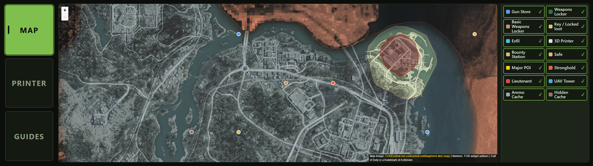
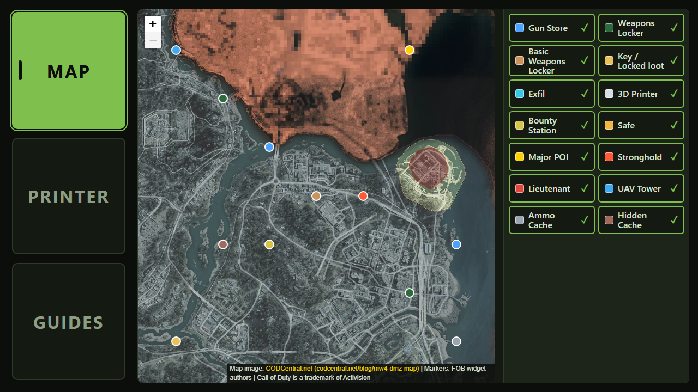
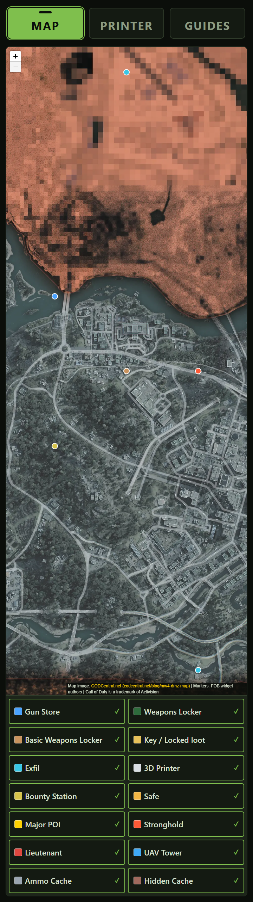

# dmz-fob-xe

A Corsair iCUE widget for the XENEON EDGE touch display that shows Call of Duty: Modern Warfare 4 DMZ reference info at a glance. It is plain HTML, CSS and JS, with no bundler needed.

## Features

- **Map**: the DMZ map, taken from codcentral.net.
- **Printer**: 3D printer recipes and ingredient costs, read from `data/printer-items.json`.
- **Guides**: placeholder tab. No guide content ships yet.

## Install into iCUE / Xeneon Edge

Official docs: https://docs.elgato.com/icue/widgets/ (Widget API). Details are summarized in `docs/research/icue-widget-conventions.md`.

1. Install iCUE 5.47 or later (use 5.47 to be safe) and have a XENEON EDGE connected.
2. Install the packaging CLI (needs Node and npm): `npm install -g icuewidget-cli`
3. Validate the widget folder: `icuewidget validate <widget-dir>`
4. Package it: `icuewidget package <widget-dir>`. This writes `<name>.icuewidget`.
5. Open iCUE, go to the Widgets panel, click "+" and select the `.icuewidget` file (or double-click the file).
6. The widget now appears for supported devices. Add it to a XENEON EDGE slot and test on the real hardware, since browser preview can differ from the device.

Network access (fetch) needs matching `permissions` entries in `manifest.json`. iCUE may show an Allow/Deny dialog for undeclared hosts.

## Local preview

No official preview tool exists. Serve the widget folder with a stub for `iCUE`, `icueEvents`, `iCUE_initialized` and `device`, then resize the browser between 2560x720 and 720x2560:

```
npx serve <widget-dir>
# or
python -m http.server 8080 --directory <widget-dir>
```

## Updating data/printer-items.json

1. Edit `data/printer-items.json`. Top-level keys: `version`, `updated`, `methodology`, `sources`, `items`.
2. Add or change entries in `items`, and add any new source to the `sources` list (`id`, `title`, `url`).
3. Bump `updated` (and `version` if the shape changes).
4. Check the file still parses: `node -e "JSON.parse(require('fs').readFileSync('data/printer-items.json','utf8'))"`
5. Reload the preview, or repackage and reinstall in iCUE.

## Screenshots

Map tab at 2560x720, 1280x720 and 720x2560:





Regenerate all nine tab/viewport shots with `npx --yes -p playwright node tools/screenshots.mjs` (see `tools/screenshots.mjs`).

## Data sources and Credits

Credits:

- DMZ map: codcentral.net, https://codcentral.net/blog/mw4-dmz-map/. Map imagery belongs to its respective owners.
- Printer recipes and item data, from the `sources` list in `data/printer-items.json`:
  - allthings.how, "MW4 DMZ where to find Electronic Sensors and High-Tenacity Fibers": https://allthings.how/mw4-dmz-where-to-find-electronic-sensors-and-high-tenacity-fibers/
  - Gamerfuzion, "MW4 DMZ 3D Printer Guide, first six recipes": https://www.gamerfuzion.com/modern-warfare-4-dmz-3d-printer-crafting-recipes-costs-resources-ingredients/
  - Gaming ProMax, "MW4 DMZ all 3D printer recipes": https://gamingpromax.com/modern-warfare-4-dmz-all-3d-printer-recipes/
  - games.gg, "How to print legendary materials in X01": https://games.gg/call-of-duty-modern-warfare-4/guides/how-to-print-legendary-materials-in-x01/
  - Destructoid, "Where to find comms modules in MW4 DMZ" (search-result summary; page returned 403 to direct fetch): https://www.destructoid.com/where-to-find-comms-modules-in-call-of-duty-modern-warfare-4-dmz/

## Disclaimer

This is an unofficial fan project. It is not affiliated with, endorsed by, or sponsored by Activision or Corsair. Call of Duty, Modern Warfare and DMZ are trademarks of Activision Publishing, Inc. Corsair, iCUE and XENEON are trademarks of Corsair Memory, Inc. All other trademarks and copyrights belong to their owners.
